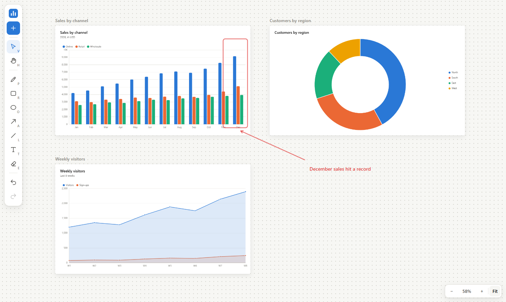
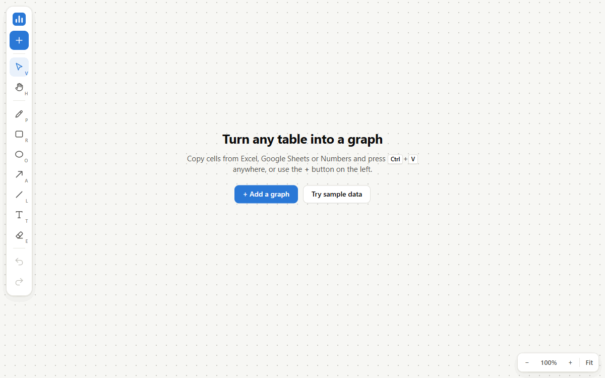
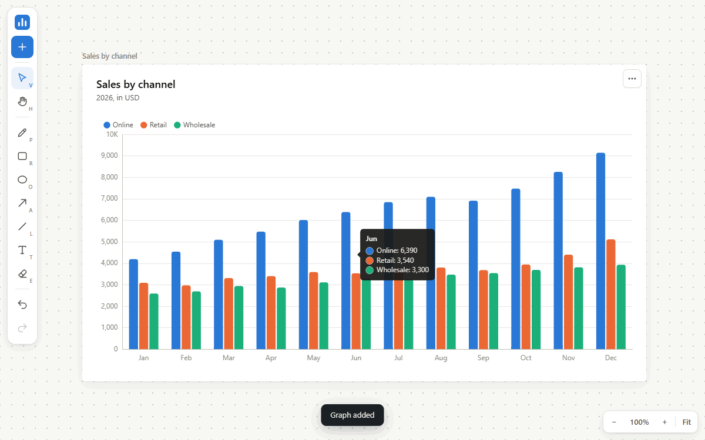
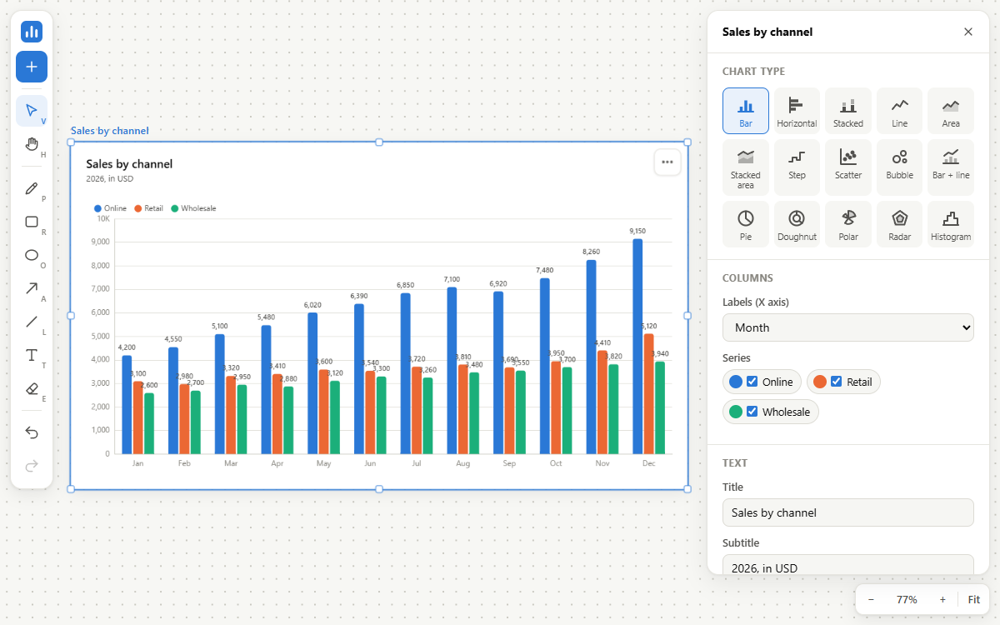
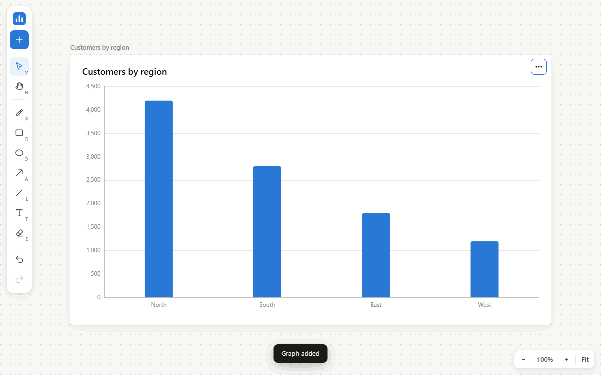
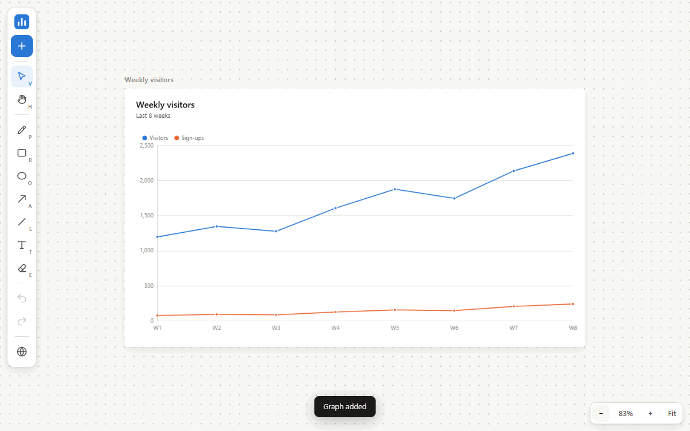
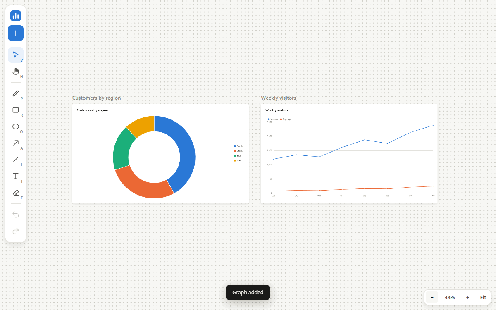
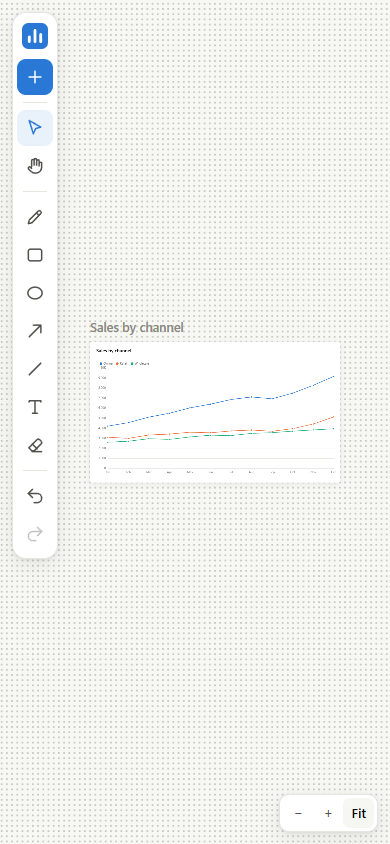

<div align="center">

# 📊 Graphitt

**Paste a table and get a graph, on a whiteboard you can draw on.**

Copy cells from Excel, Google Sheets or Apple Numbers, paste them onto a dotted drawing board, and Graphitt turns them into a clean chart.
Lay out several graphs side by side, circle the interesting bits, add arrows and notes, then download any graph as a PNG or PDF.

### [▶ Try it live](https://swaroopdiwakar007.github.io/graphitt/)



</div>

---

## Why Graphitt?

Turning a few rows of numbers into a decent-looking chart usually means opening a spreadsheet's chart wizard, fighting its defaults, and taking a screenshot. Graphitt skips all that:

- **Paste anything table-shaped.** It reads tab-separated text (what spreadsheets put on the clipboard), CSV, semicolon-separated text and Markdown tables, and it understands values like `$4,200`, `12%`, `1.234,5` and `(300)`.
- **Good-looking defaults.** Colors are a tested, colorblind-friendly set, axes and gridlines stay in the background, and titles are left-aligned.
- **A board, not a form.** Each graph sits on an infinite canvas next to your other graphs and your sketches, so you can tell a story with them.
- **Nothing to install, no sign-up.** Your data never leaves your browser.

---

## ➕ Paste a table and get a graph

Click **+** in the tool rail, or just press <kbd>Ctrl</kbd>+<kbd>V</kbd> anywhere on the board. Graphitt works out which row holds the headers and which columns contain numbers, then plots them.



You can also **upload `.csv` / `.tsv` files** (each file becomes its own graph), start from **sample data**, or begin with an **empty table** and type your numbers in.

## ⋯ Every graph has a menu

Hover over a graph and a small **⋯** button appears in its corner. It holds everything for that graph:

| | |
| --- | --- |
| **Edit graph style** | Chart type, which columns to plot, series colors, titles, legend, value labels, size and export settings |
| **Edit table** | Opens the graph's table right underneath it, ready to edit |
| **Duplicate** | Copies the graph, which is handy for showing the same data as a different chart type |
| **Bring to front** | Moves the graph above anything it overlaps |
| **Download PNG / PDF** | Exports just this graph |
| **Delete** | Removes the graph (<kbd>Ctrl</kbd>+<kbd>Z</kbd> brings it back) |

### 🎨 Edit graph style

Switch between 15 chart types and the graph redraws instantly.



<details>
<summary>All 15 chart types</summary>

| Compare amounts | Show change over time | Show parts of a whole | Show relationships and spread |
| --- | --- | --- | --- |
| Bar | Line | Pie | Scatter |
| Horizontal bar | Area | Doughnut | Bubble |
| Stacked bar | Stacked area | Polar area | Radar |
| Bar + line | Step | | Histogram |

</details>



### 🧮 Edit table

Tables stay out of the way until you ask for them. **Edit table** (or double-clicking a graph) opens it right under the graph. Click a cell, type, and the graph updates as you go. <kbd>Enter</kbd> moves down a row like a spreadsheet, **+ Row** and **+ Column** add data, and **Edit as text** shows the raw pasted text.



## ✏️ Draw on the board

The tool rail on the left has everything you need to annotate your graphs: **pen, rectangle, ellipse, arrow, line, text and eraser**. Pick a color, stroke width, fill and text size in the small panel that appears next to the rail.



## ↔️ Move, resize and zoom

Drag any graph or drawing to move it, and use the handles on its edges and corners to resize it (hold <kbd>Shift</kbd> on a corner to keep the shape). Drag empty space to pan, use <kbd>Ctrl</kbd> + scroll or pinch to zoom, and press **Fit** to see everything.



## 📱 Works on phones too



---

## Features at a glance

- **Data in:** paste anywhere, a + dialog with a live "rows · columns" check, CSV/TSV upload or drag-and-drop, sample data, and empty tables you can type into
- **Smart parsing:** tab, comma, semicolon, pipe and Markdown tables, header-row detection, "series in rows" for sideways tables, and currency, percent, thousands separators, European decimals and accounting negatives
- **Graphs:** 15 chart types, a choice of label column and series, a color per series, title, subtitle and axis titles, legend position, value labels, smooth lines, start-at-zero, gridlines and histogram bins
- **Board:** infinite dotted canvas, pan and zoom from 10% to 400%, Fit, and graphs that stay sharp when you zoom in
- **Drawing:** pen, rectangle, ellipse, arrow, line, text and eraser, 8 ink colors, 3 stroke widths, no/light/solid fill, 4 text sizes, and bring to front / send to back
- **Editing:** select, move, resize, duplicate, delete, arrow-key nudge, and undo/redo for graphs, tables and drawings alike
- **Export:** PNG at 1×–4× with a white or transparent background, or a PDF page the same size as the graph
- **Saved automatically** in your browser (localStorage), so reloading keeps your board

## Getting started

Graphitt is a static site with no build step:

```bash
git clone https://github.com/swaroopdiwakar007/graphitt.git
cd graphitt
python -m http.server 5190
```

Open **http://localhost:5190**. Any static file server works (`npx serve`, VS Code Live Server, GitHub Pages…). Chart.js and jsPDF load from a CDN, so you need an internet connection.

## Keyboard shortcuts

| Key | Tool | | Key | Action |
| --- | --- | --- | --- | --- |
| `G` or `+` | Add a graph | | `Ctrl` `V` | Paste a table as a new graph |
| `V` | Select | | `Ctrl` `Z` / `Ctrl` `Shift` `Z` | Undo / redo |
| `H`, or hold `Space` | Pan | | `Ctrl` `D` | Duplicate selection |
| `P` | Pen | | `Delete` | Delete selection |
| `R` | Rectangle | | Arrow keys (`Shift` for 10px) | Nudge selection |
| `O` | Ellipse | | `Ctrl` + scroll, or pinch | Zoom |
| `A` | Arrow | | `Ctrl` `0` | Reset zoom to 100% |
| `L` | Line | | `Shift` `1` | Fit everything on screen |
| `T` (or double-click the board) | Text | | `Esc` | Close panels / deselect |
| `E` | Eraser | | Double-click a graph | Edit its table |

## How it works

| File | What it does |
| --- | --- |
| [`index.html`](index.html) | Page shell: board, tool rail, drawing properties, style drawer, ⋯ menu, + dialog, table panel |
| [`styles.css`](styles.css) | Paper-style board with a dot grid, plus light and dark themes for the controls |
| [`app.js`](app.js) | Table parsing, chart building, the canvas engine (graphs and drawings in world space, pan and zoom, hit-testing, resize), undo history, saving, and PNG/PDF export |

**From clipboard to chart:** when you copy cells, spreadsheets put them on the clipboard as tab-separated text (and HTML, which Graphitt falls back to). `parseTable` detects the delimiter, handles quoted cells, and drops empty rows and columns. `detectHeader` decides whether the first row is a header by checking for text sitting above numbers, or year-like labels (`2022 | 2023`) above other values. A column counts as numeric when at least 80% of its filled cells parse as numbers, and those columns become the series.

**Sharp at any zoom:** the board is a CSS-transformed layer. Each graph is a real Chart.js canvas whose pixel ratio is raised as you zoom in, so text and lines don't blur. Labels, handles and the ⋯ button are scaled the other way so they stay the same size on screen.

**Exports** draw the graph again off-screen at the size you set, at 1×–4× pixel density, so the PNG doesn't depend on your current zoom. PDFs use that image on a page the same size as the graph.

## Credits

- [Chart.js](https://www.chartjs.org) for chart rendering
- [jsPDF](https://github.com/parallax/jsPDF) for PDF export
